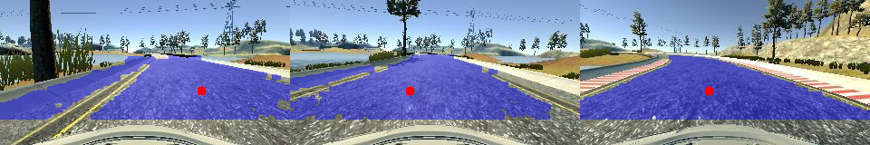
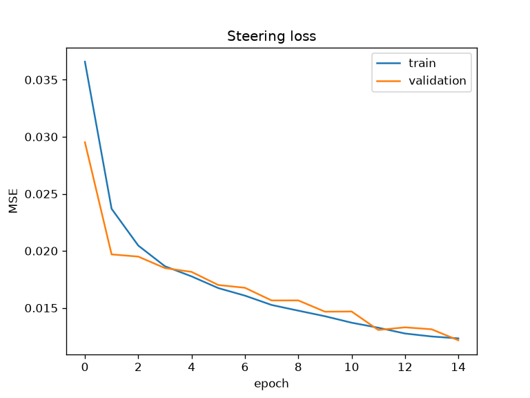

# self-driving car sim

Behavioral cloning in Udacity's car simulator. A CNN takes the front camera image and outputs a steering angle. The network is Nvidia's 2016 end-to-end model (about 250k weights) in PyTorch, trained on an RTX 3070.

Training data usually comes from a person driving laps. Here it comes from a hand-coded driver instead.

## hand-coded driver

`car/road_detect.py` samples the color just in front of the car and keeps the connected region of similar color. Yellow edge lines are treated as boundaries. The driver steers toward the center of that region (red dot).

The first version looked for gray pixels and drove into the bridge wall because the lake is also gray. The second version sampled the road color but followed the concrete shoulder once it drifted onto it. Cutting the mask at the yellow lines fixed that. The final version does full laps at 9 mph.

Every few seconds the driver swerves for about half a second, but saves the steering it would have used. This adds recovery examples to the data.

Recorded 6000 frames at 10 per second (about 2 laps). One stretch where the driver went onto the grass was removed with `data/teacher/exclude.txt`.

## result

Training took about 4 minutes on the GPU. Validation loss went from 0.030 to 0.012 and stayed close to training loss.

The trained network drove track 1 at 12 mph, faster than the driver it learned from, and completed full laps without leaving the road.

## run it (Windows)

1. `setup.bat` installs everything and downloads the simulator
2. open `sim\beta_simulator_windows\beta_simulator.exe` and pick the left track
3. `teacher.bat`, then Autonomous Mode in the sim. It records into `data\teacher`
4. `train_car.bat` writes `model.pt` (a trained one is already in the repo)
5. `drive_car.bat`, then Autonomous Mode again

The simulator uses an old socket.io version, so `python-socketio==4.6.1` and `python-engineio==3.13.2` are pinned. Newer versions won't connect.

Laps recorded manually in Training Mode into any folder under `data\` also work. `train.py` picks them up, including side cameras.
